<p align="center">
  <picture>
    <source media="(prefers-color-scheme: dark)" srcset="docs/assets/readme/logo-dark.svg">
    
  </picture>
</p>

<h1 align="center">Nyx.</h1>

<p align="center">
  <b>A menu bar utility and Dynamic Island for your Mac.</b><br>
  Built on <a href="https://github.com/vorssaint/vorssaint-utils">Vorssaint</a>. Install only what you use.
</p>

<p align="center">
  <a href="#about">About</a> ·
  <a href="#whats-new-in-nyx">What's new</a> ·
  <a href="#features">Features</a> ·
  <a href="#install">Install</a> ·
  <a href="#private-by-default">Privacy</a> ·
  <a href="#upstream--acknowledgements">Upstream &amp; Acknowledgements</a>
</p>

<p align="center">
  <a href="https://github.com/Aareevs/Nyx/releases/latest"></a>
  
  <a href="LICENSE"></a>
  <a href="https://github.com/vorssaint/vorssaint-utils"></a>
</p>

Per app volume, a real system monitor, a better app switcher, window snapping, Dock previews, clipboard history, text snippets, a file shelf, an uninstaller, plus a Dynamic Island with music, calendar, alarms and AI usage. The utilities Mac users usually buy one by one, together behind a single menu bar icon, with no account, no telemetry and no subscription.

> [!IMPORTANT]
> Nyx is not signed with a paid Apple Developer ID, so macOS blocks it the first time. Open it once, then go to **System Settings → Privacy & Security** and click **Open Anyway**. See [Install](#install).

## About

Hey! I'm [Aareevs](https://github.com/Aareevs). Nyx is my daily-driver Mac utility app, a personal fork of the wonderful [Vorssaint](https://github.com/vorssaint/vorssaint-utils) by [@vorssaint](https://x.com/vorssaint).

I love Vorssaint's all-in-one idea, but I found a few things lacking, and some features that felt too overbearing for me. So I made my own version, shaped around how I actually use my Mac:

- **Built around the island.** Music with your Spotify playlists and what plays next, a calendar you can add events to, alarms that keep ringing until you stop them, a calculator, and live AI agent usage with limits and reset times, all around the camera cutout.
- **Lighter by choice.** The features that felt like too much are gone: Fan Control, Kill Process, Port Manager, Homebrew management and the extra languages. That means no privileged helper and about 20% less code to trust.
- **Install only what you use.** Pick the features you want or start from a preset. Anything you uninstall stops loading and disappears from the interface.

If you like a tidy, all-in-one Mac setup that stays out of your way, you might enjoy it too. It is released under the same GPL-3.0 license as the original.

## What's new in Nyx

Nyx started from the open-source [Vorssaint](https://github.com/vorssaint/vorssaint-utils) and has since gone its own way. These are the things it has that Vorssaint does not:

- **Spotify in the island.** Browse your playlists, reorder them, play any song and see what's up next, all from the island. Needs **Spotify Premium**. See [Spotify in the Dynamic Island](#spotify-in-the-dynamic-island).
- **Time and weather on the island.** The closed island shows the time on the left and the weather, with an emoji, on the right. The weather uses your approximate location if you allow it (Open-Meteo, with MET Norway as a fallback, no account).
- **Calculator in the island.** A new section with three modes: basic arithmetic (powers, roots, fractions), trigonometry (sin, cos, tan, csc, sec, cot and their inverses, in degrees or radians), and calculus (derivatives, integrals, complex numbers, factorials). Shortcut ⌥⌘K.
- **Alarms in the island.** A new section for alarms that ring from the island: set a time with scroll wheels, add a label, and repeat on the days you pick, or ring once. A ringing alarm plays a sound and stays on the closed island with a **Stop** button until you stop it, and the Alarms page can snooze it for 5 minutes. Shortcut ⌥⌘L. Nyx has to be running for an alarm to ring.
- **Add events to Calendar.** The island's Calendar page has a **+** button that opens a small form for a title, date and time, all day, and which calendar to save to. Events go into the Calendar app, so they sync as usual.
- **Teleprompter in the island.** A new section for reading a script while you record or present. Type it in the built-in editor or paste it, set the speed in WPM, and follow the current line with the lines before and after it dimmed, a progress bar and the time left. Lines fill the width of the island, and a resize button on the page switches between the normal and a larger size. It can hide the island from screen recordings and screenshots (on by default; some screen-sharing apps may still show it). Shortcut ⌥⌘E.
- **Streaks in the island.** Add your GitHub and LeetCode usernames and the island shows each streak with a flame, whether today is done, and your best run. The closed island greets a streak with its logo and an animated flame, and at a time you pick it rings like an alarm only if a streak is still open, then stops once you have done it. Off by default; it looks the usernames up online (see the privacy notes), counts days in UTC, and GitHub only counts private contributions if your profile shows them. Shortcut ⌥⌘J.
- **A full color picker.** The Color picker now opens a panel instead of sampling the screen straight away: a gradient square and hue slider, an editable hex value, HEX, RGB and HSL rows with a copy button each, WCAG contrast against white and black, a list of recent colors, and a Pick from screen button.
- **Edit clipboard text in Scratchpad.** Text entries in the island's Clipboard have a pen button that opens the text in Scratchpad.
- **Menu bar folder.** Collapse the menu bar icons you rarely use into one folder, and click through to them without leaving the bar.
- **Antigravity usage.** The AI agents section reads Antigravity's conversations and shows its token use, models and cost, with its own card and the Gemini mark. Also, in settings can turn off showing Antigravity as working.
- **Claude limits fixed up.** Claude plan limits are read more reliably, and limit bars now default to showing how much you have used.
- **Copy image** on Recent Captures and on the Shelf, so a screenshot goes straight to your clipboard.
- **Downloads show their date.** Each finished download in the island lists when it was saved.
- **Back buttons on the Tools page** in the island, and on the tools that open from the menu panel, so you are never stuck inside a tool.
- **Check for updates.** **Settings → General → Updates** looks at the Nyx releases page and tells you when a newer version is out, with a Download button. Turn on the daily check if you want it to look on its own. It never installs anything by itself.
- **Smoother, lighter app.** Fan Control, Kill Process, Port Manager, Disk Image Installer, Homebrew management, feedback and link sharing are gone, along with the extra languages (English only), so there is no privileged helper and far less code to trust. The source is about 20% smaller.

## Features

### Install only what you use

Setup asks only for the permissions your choices need. Reorder or hide panel sections, choose a compact layout, and export settings to another Mac.

<details>
<summary><b>Screenshots</b></summary>
<br>

<p align="center">
  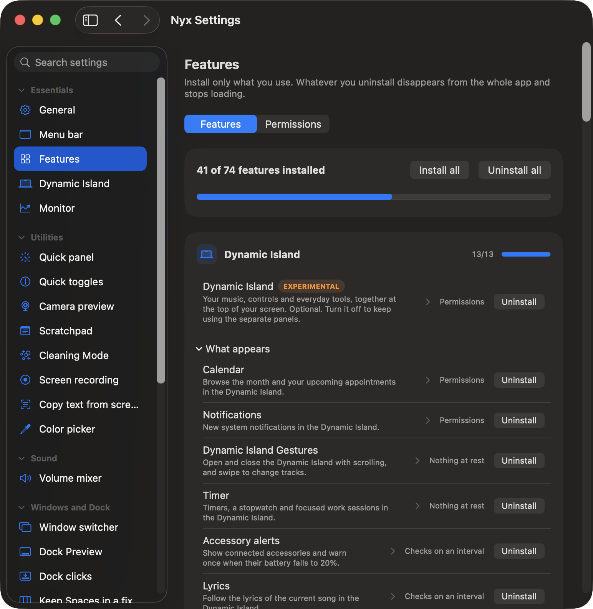
  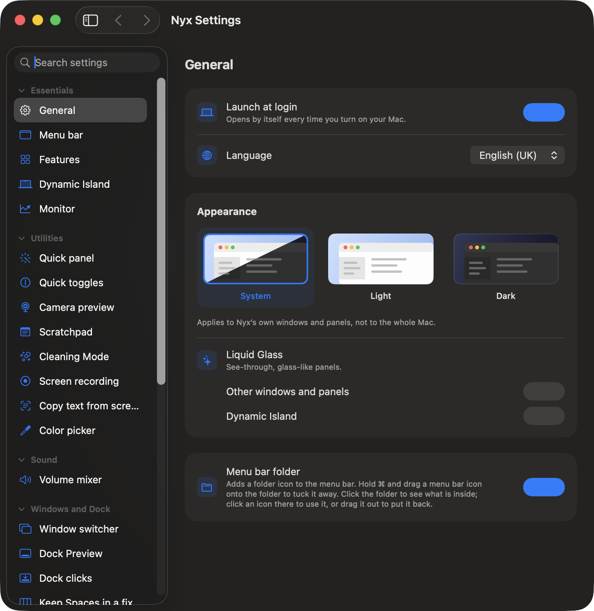
</p>

</details>

### Sound

Volume mixer · Per app output · Output switcher · Microphone tools · Music app blocker

<details>
<summary><b>Details and screenshots</b></summary>
<br>

- **Volume mixer.** Set volume per app, boost quiet audio past 100%, and pin or reorder favorites.
- **Per app output.** Play music through speakers while a call uses your headset.
- **Output switcher.** Switch audio outputs with a shortcut and lower the volume when headphones disconnect.
- **Microphone tools.** Choose a preferred input, adjust its level on supported devices, and apply available microphone mute or input-volume controls with one shortcut.
- **Music app blocker.** Prevent unwanted Music launches after detected playback-button presses.

<p align="center">
  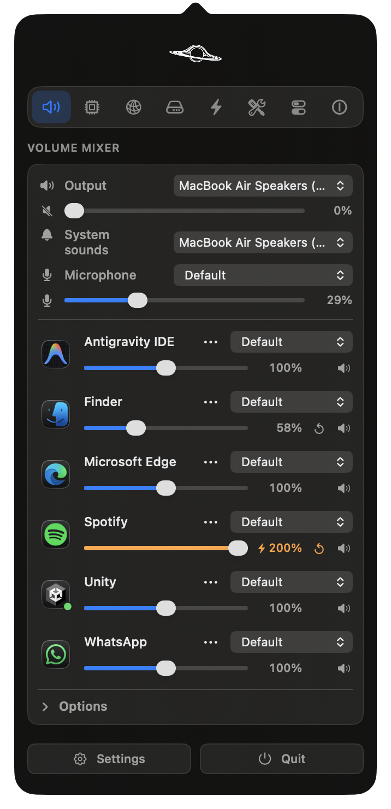
</p>

</details>

### Know what your Mac is doing

System monitor · Menu bar readouts · Network · Alerts

<details>
<summary><b>Details and screenshots</b></summary>
<br>

- **System monitor.** CPU, GPU, memory, temperatures, battery health and power use, with history graphs and a view of energy-hungry apps.
- **Menu bar readouts.** Put your chosen readings, usage bars, or battery time directly in the menu bar.
- **Network.** See live traffic, session totals and your local IP address, or run a speed test.
- **Alerts.** Get notified about sustained CPU load, high temperatures, memory pressure, low disk space or low battery.

<p align="center">
  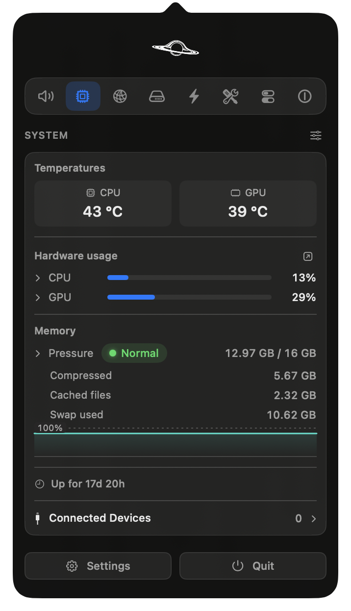
</p>

</details>

### Windows and the Dock

App switcher · Window layout · Dock Preview · Dock clicks · Maximize windows · Fixed Space order · Quit on close · Quit and close protection

<details>
<summary><b>Details and screenshots</b></summary>
<br>

- **App switcher.** Switch between apps and windows with live previews, search and display filters.
- **Window layout.** Snap windows into layouts, move them between displays and restore earlier positions using shortcuts, screen edges or modifier-drag gestures.
- **Dock Preview.** Hover over Dock icons to preview windows across desktops.
- **Dock clicks.** Click an active app's Dock icon to minimize, hide or cycle through its windows.
- **Maximize windows.** Use the green button to fill the screen without creating another Space.
- **Fixed Space order.** Keep Spaces in the order you set instead of rearranging them by recent use.
- **Quit on close.** Quit selected apps when their last window closes.
- **Quit and close protection.** Prevent accidental ⌘Q or ⌘W with a hold, double press or extra modifier, per app.

<p align="center">
  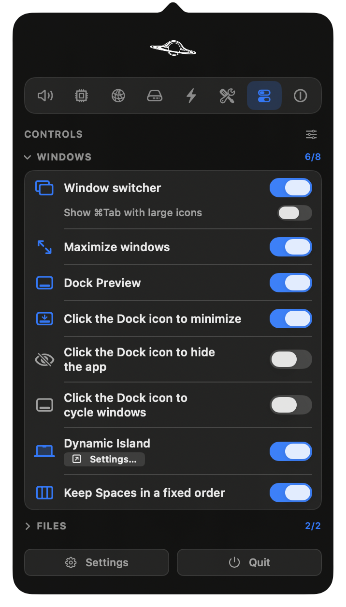
  
</p>

</details>

### Keyboard and mouse

Text snippets · Smooth scrolling · Pointer acceleration · Linear scrolling · Focus follows mouse · Scroll direction · Scroll sideways while holding a key · Side buttons · Mouse button shortcuts · Middle click · Apps to leave alone · Extra click filter · Key debounce · Super key · Keyboard shortcuts

<details>
<summary><b>Details</b></summary>
<br>

- **Text snippets.** Expand short triggers into text with clipboard, date and time variables, or insert snippets from a searchable menu.
- **Smooth scrolling.** Give your mouse wheel a fluid glide with adjustable speed and response.
- **Pointer acceleration.** Disable mouse acceleration and restore your previous setting when turned off.
- **Linear scrolling.** Make every mouse wheel notch scroll the same number of lines, however fast the wheel spins.
- **Focus follows mouse.** Bring the window under the pointer forward after an adjustable pause.
- **Scroll direction.** Invert vertical and horizontal mouse scrolling independently of the trackpad.
- **Scroll sideways while holding a key.** Turn vertical wheel movement into horizontal scrolling while holding a chosen key.
- **Side buttons.** Use mouse Back and Forward buttons in Finder, browsers and compatible apps.
- **Mouse button shortcuts.** Assign keys to extra buttons and side wheels, or use button-drag gestures for Spaces and Mission Control.
- **Middle click.** Turn a three-finger trackpad press into a middle click.
- **Apps to leave alone.** Exclude chosen apps from mouse enhancements.
- **Extra click filter.** Ignore accidental rapid clicks from worn mouse buttons without delaying normal clicks.
- **Key debounce.** Filter repeated letters caused by a worn keyboard.
- **Super key.** Use Caps Lock or a right-side modifier as a shortcut combination, with a separate tap action and app exclusions.
- **Keyboard shortcuts.** Manage feature shortcuts in one place, including optional takeover of supported macOS shortcuts while a feature is active.

</details>

### Clipboard, files and links

Clipboard history · Auto clear clipboard · Paste as plain text · Shelf · Finder shortcuts · Clean URL

<details>
<summary><b>Details and screenshots</b></summary>
<br>

- **Clipboard history.** Search local text, image and file history, pin favorites, preview entries and paste with shortcuts.
- **Auto clear clipboard.** Clear the system clipboard after a delay, sleep or lock, while keeping saved history.
- **Paste as plain text.** Paste without formatting while preserving the original clipboard content.
- **Shelf.** Park files, text and links near your cursor while dragging, then drop or share them later.
- **Finder shortcuts.** Move files with ⌘X and ⌘V, rename with F2, or paste copied images as PNG files.
- **Clean URL.** Remove tracking parameters from links, manually or automatically.

<p align="center">
  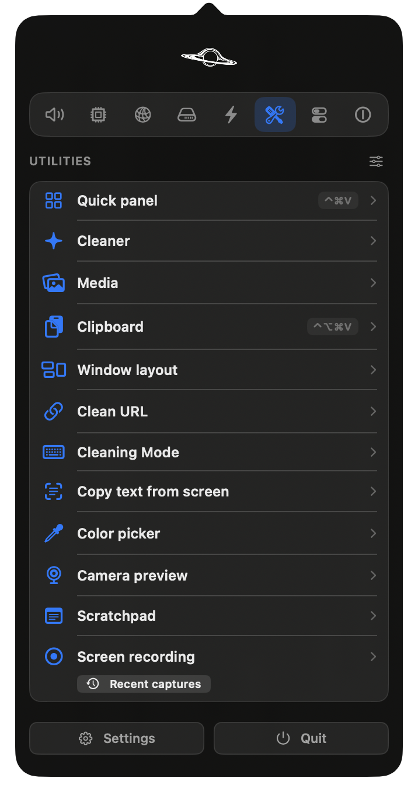
</p>

</details>

### Everyday tools

Dynamic Island · AI agents · Command Bar · Quick panel · Quick toggles · Quit apps · Radial menu · Scratchpad · Streaks · Teleprompter · Cleaning Mode

<details>
<summary><b>Details and screenshots</b></summary>
<br>

- **Dynamic Island.** Keep music (with your Spotify playlists), notifications, calendars, timers, downloads and everyday controls around the camera cutout, or a simulated one on other Macs.
- **AI agents.** Follow Claude, Codex, OpenCode, GitHub Copilot and Antigravity in the Dynamic Island: plan limits and when they reset where available, tokens, API value, models, projects and live work, with a notice when a long task finishes.
- **Command Bar.** Search apps, windows, files, clipboard history, snippets and app menu commands from one field.
- **Quick panel.** Open a floating palette of favorite tools with ⌃⌘V.
- **Quick toggles.** Switch appearance, hide desktop icons, eject disks, empty the Trash, lock the screen and more.
- **Quit apps.** See every open app in one list and quit them one by one, all at once or all but the one in front.
- **Radial menu.** Open a customizable wheel of apps, files, shortcuts and tools around the pointer, with profiles and submenus.
- **Scratchpad.** Keep autosaved notes in tabs, with Markdown preview and export, in a floating window or Dynamic Island.
- **Teleprompter.** Read a typed or pasted script line by line from the Dynamic Island at a speed you set, switch it to a larger size, and keep the island hidden from screen recordings.
- **Streaks.** Keep your GitHub and LeetCode streaks alive from the Dynamic Island: a card for each with a flame, "done today" or "not done yet", and your best run, a closed-island animation when you extend one, and a reminder that rings only while a streak is still open. Off by default, public usernames only.
- **Cleaning Mode.** Lock keyboard input while cleaning, with a black screen or a small visible indicator.

<p align="center">
  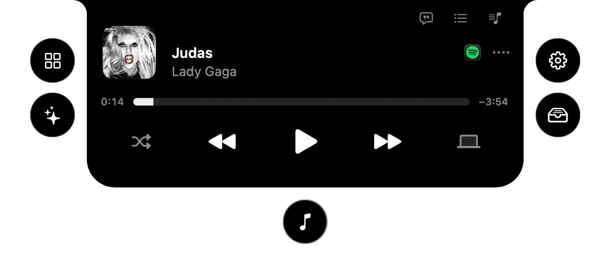
  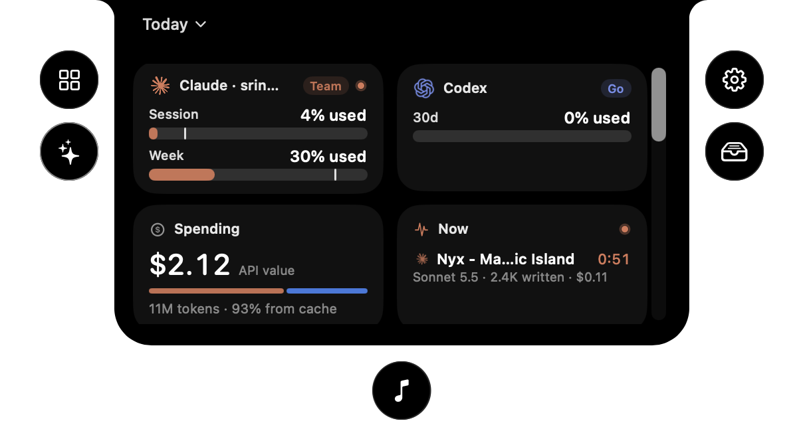
  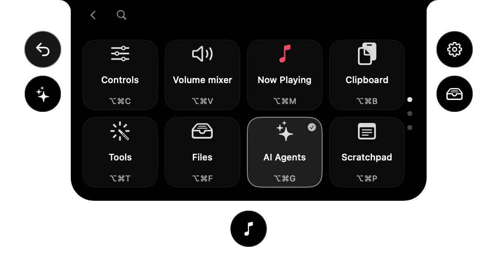
</p>

</details>

### Spotify in the Dynamic Island

Playlists · Play a song · Reorder · Up next

> [!IMPORTANT]
> **Choosing and playing songs needs a Spotify Premium account.** Spotify only lets apps control playback for Premium users, so on a free account you can browse your playlists but not play from them.
>
> Nyx's Spotify connection is in Spotify's development mode, so **the developer has to add you first.** Until then, signing in shows "You need a Spotify Premium account, and the developer has to add you first."

<details>
<summary><b>Details and screenshots</b></summary>
<br>

- **Sign in once.** Connect from the island's Spotify page. The login uses PKCE, so no secret is stored, and it is kept in a private file only your account can read.
- **Playlists.** Browse your playlists, open one and tap a song to play it on Spotify without opening the app. Use the arrows button to reorder your playlists.
- **Up next.** See the next five songs from Spotify, or from a YouTube playlist in your browser, and tap one to jump to it.
- **YouTube queue.** Turn on **Allow JavaScript from Apple Events** in your browser's developer menu, and switch on the queue lookup in **Settings → Dynamic Island → Music**.

<p align="center">
  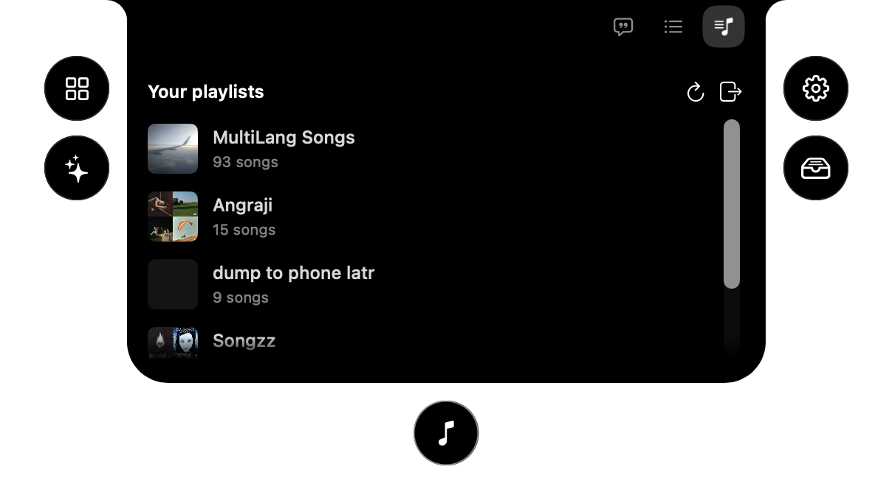
</p>

</details>

### Capture and create

Screen capture · Screenshot · Screen recording · Camera preview · Copy text from screen · Color picker · Media tools

<details>
<summary><b>Details</b></summary>
<br>

- **Screen capture.** Switch between screenshots, recording, text recognition and color picking in one selector with a pixel magnifier.
- **Screenshot.** Capture an area, window, screen or scrolling page.
- **Screen recording.** Record with separate system-audio and microphone tracks.
- **Camera preview.** Check your camera in a floating mirror or Dynamic Island before a call.
- **Copy text from screen.** Recognize text offline from any screen area, or read a QR code.
- **Color picker.** A full picker panel: drag a color on the gradient square and hue slider, type a hex value, see HEX, RGB and HSL with a copy button each, check its contrast against white and black, and reuse recent colors. Pick from screen loads any pixel into the panel.
- **Media tools.** Compress and edit videos, batch-convert images, add watermarks, make GIFs and extract text, all locally.

</details>

### App management

App updates · Cleaner · Messaging downloads · Uninstaller

<details>
<summary><b>Details</b></summary>
<br>

- **App updates.** Check store apps and supported developer feeds in one list, and open an app's own updater.
- **Cleaner.** Remove caches, logs and app leftovers, manually or on a schedule.
- **Messaging downloads.** Review, organize or move messaging downloads to the Trash using retention rules.
- **Uninstaller.** Remove apps and review their related caches, preferences and helpers before moving them to the Trash.

</details>

### Energy and display

Keep awake · Displays · Extra brightness · Bluetooth on sleep

<details>
<summary><b>Details</b></summary>
<br>

- **Keep awake.** Keep your Mac working on a timer, with the lid closed, or while selected apps, power or external displays are present.
- **Displays.** Control individual displays and brightness, with hardware control where supported, half or quarter steps for the brightness keys, optional extra dimming below a monitor's minimum, and software dimming as a fallback.
- **Extra brightness.** Use a MacBook Pro XDR display's HDR headroom to go beyond its normal maximum brightness.
- **Bluetooth on sleep.** Disconnect Bluetooth during sleep and restore it on wake only if Nyx turned it off.

</details>

## Install

1. Download `Nyx-<version>.dmg` from the [latest release](https://github.com/Aareevs/Nyx/releases/latest).
2. Open it and drag **Nyx** into **Applications**.
3. Open Nyx. The first time, macOS blocks it, because Nyx is not signed with a paid Apple Developer ID. Go to **System Settings → Privacy & Security**, scroll down and click **Open Anyway**.
4. Allow only the permissions the features you want ask for.

Optional, to see what plays next from YouTube: in your browser's menu bar turn on **View → Developer → Allow JavaScript from Apple Events** (Safari: **Develop → Developer Settings**), then switch on the queue lookup in **Settings → Dynamic Island → Music**. Spotify only needs you to sign in from the Up next page.

To update, use **Settings → General → Updates → Check for updates**, then download the new `.dmg` and drag Nyx into Applications again, replacing the old one. Your settings and permissions stay. macOS may ask for **Open Anyway** once more.

## Uninstall

To remove Nyx completely, including its settings and permissions:

```sh
./Tools/uninstall.sh
```

## Private by default

Nyx is local-first, with no account, analytics or tracking. The network is touched only by things you can see: the speed test, optional online lyric lookup and the app update check for other apps you run yourself. The full story is in the [privacy notes](docs/PRIVACY.md).

Permissions get the same treatment. Every one is optional, the app explains each in plain words, shows which features actually use it, and even tells you when a permission you granted is no longer needed by anything, with a shortcut to revoke it.

<details>
<summary><b>Screenshot</b></summary>
<br>

<p align="center">
  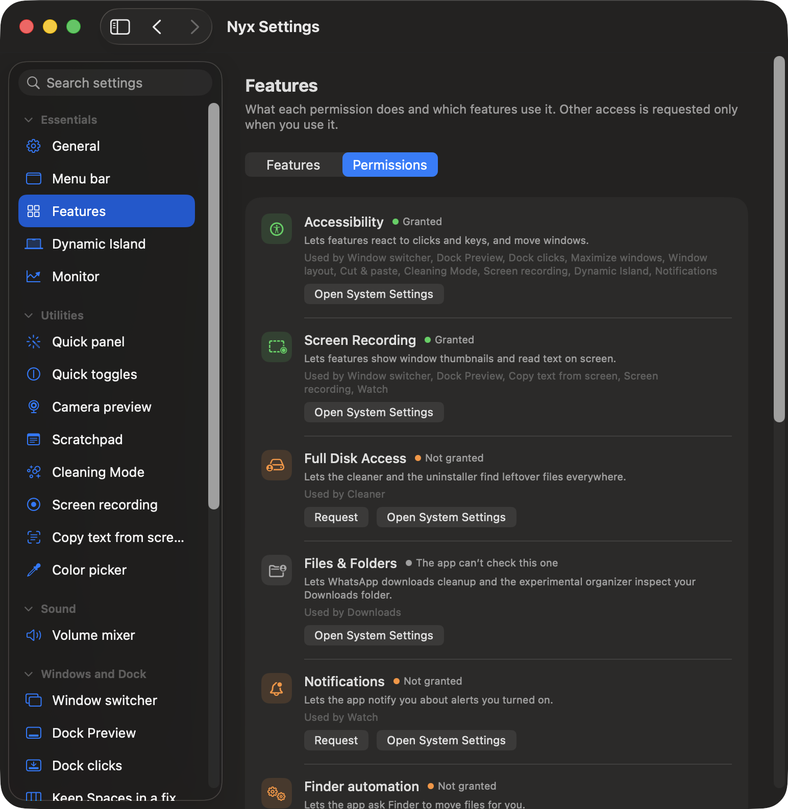
</p>

</details>

See the [permissions guide](docs/PERMISSIONS.md) for which features need access and what remains available without it.

## What you need

- A Mac with Apple Silicon
- macOS 14 Sonoma or newer

### Build it yourself

```sh
cd path/to/nyx
./build.sh --dev            # build the separate Developer variant
./build.sh --dev --install  # install and launch it
./build.sh --install        # build and install the regular Nyx app
./Tools/make-release.sh     # package dist/Nyx-<version>.dmg to share
```

Xcode Command Line Tools are the only requirement.

## When something misbehaves

See [troubleshooting](docs/TROUBLESHOOTING.md) for launch problems, permissions and missing previews.

## Documentation

- [Privacy](docs/PRIVACY.md), what does and does not leave your Mac
- [Permissions](docs/PERMISSIONS.md), every macOS permission in plain words
- [Troubleshooting](docs/TROUBLESHOOTING.md), the common fixes

## Upstream & Acknowledgements

Nyx is built on [Vorssaint](https://github.com/vorssaint/vorssaint-utils), an open-source macOS utility by [@vorssaint](https://x.com/vorssaint). The original idea, structure and a large part of the code come from that project, and it is where to look for the upstream version. Everything under "What's new in Nyx" above was added on top by [Aareevs](https://github.com/Aareevs).

The GitHub and LeetCode logos in Streaks are trademarks of their owners and are used only to label those services.

## License

[GPL 3.0 or later](LICENSE). Nyx is a modified version of Vorssaint, copyright 2026 Vorssaint, with Nyx's own changes copyright 2026 [Aareevs](https://github.com/Aareevs). As the license requires, the source stays open under the same terms. The Vorssaint name, logo and look are not part of this license (see the original [TRADEMARKS.md](https://github.com/vorssaint/vorssaint-utils/blob/main/TRADEMARKS.md)), and Nyx uses its own name, icon and identity.
